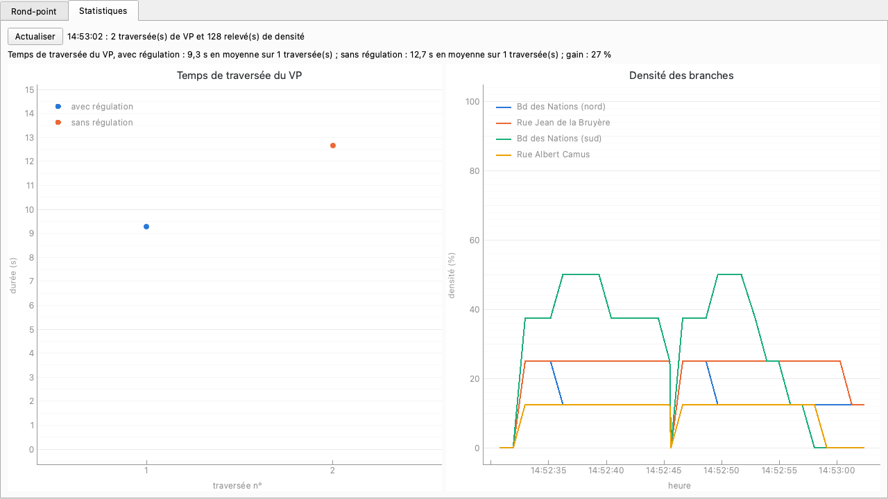

# CherryPie : rond-point connecté

Projet de la SAÉ 3.02 « Développer une application communicante » (BUT R&T, IUT de Colmar).

Maquette logicielle du rond-point sans feux situé vers l'arrêt Bel Air, à Mulhouse (rond-point André Marie Talvas). Tous les usagers (voitures, motos, trottinettes, piétons et véhicules prioritaires) sont connectés à un serveur qui représente le rond-point. Le but est de faire traverser un véhicule prioritaire le plus vite et le plus sûrement possible, en demandant aux autres usagers de lui laisser le passage.

L'application se découpe en trois parties :

- le **serveur**, qui tient le registre des usagers, calcule la densité de chaque branche, envoie les consignes et écrit l'historique dans une base MariaDB ;
- les **clients usagers**, qui se déplacent sur le rond-point et suivent ces consignes ;
- la **supervision**, une fenêtre PyQt6 qui affiche le rond-point en 2D, permet de créer des usagers et présente les statistiques.

## Équipe

Groupe CherryPie, BUT2 R&T de l'IUT de Colmar : Yassine et Ilkan.

## Prérequis

- Python 3.11 ou plus récent, avec le module `venv` (sous Debian : `sudo apt install -y python3 python3-venv`) ;
- git ;
- MariaDB pour l'historique et les statistiques (voir « Installation de MariaDB sur Debian »). Sans base, le serveur et la supervision fonctionnent : seules les statistiques manquent.

## Installation

```bash
git clone https://github.com/vRayzix/SAE3.02_Developper-une-application-communicante.git
cd SAE3.02_Developper-une-application-communicante
python3 -m venv .venv
source .venv/bin/activate          # sous Windows : .venv\Scripts\activate
pip install -r requirements.txt
cp config.exemple.ini config.ini   # sous Windows : copy config.exemple.ini config.ini
```

`requirements.txt` ne contient que ce qu'il faut pour faire tourner le projet : PyQt6, pyqtgraph et mysql-connector-python, en versions exactes. Pour lancer les tests, on installe en plus les outils de développement :

```bash
pip install -r requirements-dev.txt   # requirements.txt, plus pytest et pytest-timeout
```

`config.ini` n'est pas versionné : il contient la clé HMAC partagée et les identifiants de la base. Les valeurs d'exemple sont à remplacer.

La configuration d'exemple décrit le rond-point de Bel Air : quatre branches en double chaussée (le boulevard des Nations, côté nord et côté sud, la rue Jean de la Bruyère et la rue Albert Camus), chacune dans sa section `[branche.<identifiant>]` avec son nom de rue, son cap, la largeur de son terre-plein et la position de son passage piéton, et un anneau à deux voies. Les mesures et les choix de modélisation sont dans [docs/geometrie_bel_air.md](docs/geometrie_bel_air.md).

## Lancer le serveur

```bash
python scripts/lancer_serveur.py                  # lit config.ini à la racine du dépôt
python scripts/lancer_serveur.py autre_config.ini
```

Le serveur écoute en TCP sur le port 5050 et en UDP sur le port 5051 (réglables dans `config.ini`), et journalise dans la console les connexions, les inscriptions et les trames refusées. Ctrl+C ou `kill` l'arrêtent proprement.

Ces ports évitent le 5000, que le récepteur AirPlay occupe déjà sur toutes les interfaces sous macOS.

## Lancer la supervision

```bash
python scripts/lancer_supervision.py                  # lit config.ini à la racine du dépôt
python scripts/lancer_supervision.py autre_config.ini
```

La fenêtre s'ouvre en plein écran et peut être lancée avant le serveur : elle s'y connecte dès qu'il répond, et s'y reconnecte s'il redémarre. Elle ne descend pas sous 1000 × 640 pixels, et tout y reste visible à cette taille, par exemple sur l'écran d'un MacBook. À gauche, elle montre :

- le rond-point en 2D, dessiné d'après `config.ini` : les deux chaussées de chaque branche et leur terre-plein, les deux voies de l'anneau, les passages piétons et le nom de chaque rue. La scène suit la taille de la fenêtre ;
- chaque usager à son gabarit, tourné dans son sens de marche, coloré selon sa catégorie et cerclé selon la consigne qu'il suit ; le véhicule prioritaire a un halo. Avec DEGAGEZ, on voit un usager passer de la voie intérieure à la voie extérieure ; avec CHANGEZ_VOIE, un usager devant le VP sur sa branche se range au bord de sa chaussée et s'arrête, puis le VP, qui roule sur la gauche de sa chaussée, le double ;
- en orange, la voie intérieure des segments réservés au véhicule prioritaire, et une barre rouge sur la ligne de chaque entrée temporisée, avec un feu à côté. Une barre rouge ferme aussi la demi-chaussée qu'un piéton est en train de traverser, et elle seule ;
- la densité de chaque branche, écrite en pourcentage sous le nom de la rue et rendue par la couleur de la bande le long de la chaussée d'entrée : vert pour faible, jaune pour moyenne, rouge pour forte ;
- la légende de tout cela, sous la scène.

À droite, un séparateur que l'on peut déplacer laisse la place à un panneau qui défile si la fenêtre manque de hauteur. On y trouve l'état de la connexion, la régulation en vigueur sur le serveur, la présence d'un véhicule prioritaire et l'interrupteur « Régulation active », qui active ou coupe la régulation sur le serveur. Viennent ensuite deux onglets.

- **Scénario** : on compose la suite des lancements. Pour chaque ligne, on choisit le type d'usager, la rue d'entrée, la rue de sortie (imposée pour un piéton), le nombre d'usagers et le délai de départ, compté en secondes depuis la ligne précédente, puis « Ajouter au scénario ». Les lignes se suppriment, se montent ou se descendent avec les boutons ou par glisser-déposer, et « Vider » efface tout. Pour corriger une ligne, on la sélectionne puis « Modifier » (ou un double-clic) : ses valeurs reviennent dans le formulaire, et « Valider la modification » la remplace à sa place, sans changer l'ordre. « Lancer le scénario » envoie les lignes dans l'ordre, chacune à son délai, avec un client par usager, qui se connecte au serveur comme n'importe quel autre. « Arrêter tout » annule les lignes pas encore parties et arrête les clients lancés.

  « Enregistrer le scénario… » écrit la liste dans un fichier JSON, et « Ouvrir un scénario… » la recharge. C'est ce qui permet de mesurer ce qu'apporte la régulation : on joue un scénario avec la régulation active, on coupe l'interrupteur, puis on rouvre le même fichier et on le relance. Les deux traversées du véhicule prioritaire se font dans le même trafic, et l'écart entre leurs durées vient de la régulation seule.
- **Suivi** : les clients en route, avec leur trajet, l'état de leur connexion et la consigne qu'ils suivent. Dessous, une seule liste rassemble les messages, le plus récent en haut, une ligne par message : les consignes reçues par ces clients (« 15:31:14  voiture_3 ← DEGAGEZ : Véhicule prioritaire derrière vous : ralentissez et serrez à droite. »), et les événements du serveur : véhicule prioritaire annoncé, avec son trajet et son arrivée prévue à l'anneau, fin de sa traversée, entrée temporisée ou libérée, passage piéton fermé ou rouvert, régulation activée ou coupée. Chaque ligne a la couleur de sa consigne (orange pour ATTENDEZ, jaune pour DEGAGEZ, bleu clair pour CHANGEZ_VOIE, vert pour OK_PASSER, gris pour un événement). Un message identique au précédent complète sa ligne au lieu d'en ouvrir une : « voiture_1, voiture_2 et 3 autres ← OK_PASSER », « Entrée libérée : Rue Albert Camus, Bd des Nations (sud) ». La liste garde les 100 derniers messages.

Un second onglet de la fenêtre, **Statistiques**, montre le temps de traversée de chaque véhicule prioritaire, en bleu avec régulation et en orange sans, avec le temps moyen de chaque mode et le gain, puis la densité de chaque branche dans le temps. La supervision ne se connecte jamais à la base : à l'ouverture de l'onglet, ou par « Actualiser », elle demande les statistiques au serveur, qui les lit en base et les lui renvoie. Si la base est injoignable, l'onglet le dit.

Fermer la fenêtre, ou faire Ctrl+C dans la console, annule le scénario en cours, arrête les clients lancés depuis la fenêtre et coupe la connexion au serveur.

### Captures

Les captures montrent le même scénario : trois voitures en file sur le boulevard des Nations côté sud, deux rue Jean de la Bruyère, une moto rue Albert Camus, une trottinette et un piéton sur le boulevard des Nations côté nord, tous lancés ensemble. Le véhicule prioritaire part 3,5 s plus tard et traverse le boulevard, du sud vers le nord. La capture du dépassement est prise 2,4 s après son départ, les deux suivantes 8 s après.

Avant l'arrivée du véhicule prioritaire :


Avec régulation, les trois voitures parties devant lui sur le boulevard se rangent au bord de leur chaussée et s'arrêtent ; il les double sans ralentir, en serrant la gauche :


Une fois doublées, elles reprennent leur voie et attendent sa sortie à leur ligne, comme les entrées qui croisent sa trajectoire. Il roule déjà sur la voie intérieure :


Sans régulation, il vient seulement d'atteindre l'anneau : il a attendu derrière la file, puis cédé le passage aux voitures déjà engagées :


La section « Suivi », peu après le passage du véhicule prioritaire :


La même fenêtre en 1024 × 640, 1280 × 720 et 1440 × 800 : [1024 × 640](docs/captures/fenetre_1024x640.png), [1280 × 720](docs/captures/fenetre_1280x720.png), [1440 × 800](docs/captures/fenetre_1440x800.png).

L'onglet Statistiques, après ces deux traversées :



`python scripts/generer_captures.py` refait ces images : il lance un serveur et la fenêtre dans le même processus, sans rien afficher à l'écran.

## Scénarios de démonstration

`docs/scenario_demonstration.json` est le scénario des captures : trois voitures en file sur le boulevard des Nations côté sud, deux rue Jean de la Bruyère, une moto, une trottinette et un piéton, puis le véhicule prioritaire 3,5 s plus tard, du sud vers le nord. Pour mesurer ce qu'apporte la régulation :

1. lancer le serveur, puis la supervision ;
2. dans l'onglet Scénario, « Ouvrir un scénario… » et choisir `docs/scenario_demonstration.json`, puis « Lancer le scénario » ;
3. une fois le véhicule prioritaire sorti, décocher « Régulation active » ;
4. relancer le même scénario ;
5. ouvrir l'onglet Statistiques : les deux traversées y sont, avec le temps moyen de chaque mode et le gain.

Chaque scénario composé dans la supervision s'enregistre de la même façon (« Enregistrer le scénario… ») pour être rejoué à l'identique.

## Historique en base

Le serveur écrit dans MariaDB :

- chaque traversée de véhicule prioritaire : début, fin, durée, durée sur l'anneau, régulation active ou non, densité moyenne pendant la traversée (table `passage_vp`) ;
- toutes les `intervalle_releves` secondes, la densité de chaque branche (table `releve_densite`) ;
- chaque connexion et chaque déconnexion d'usager, avec sa raison (table `evenement_connexion`).

`python scripts/init_bdd.py` crée ces tables à partir de `src/cherrypie/bdd/schema.sql`, avec les identifiants de la section `[bdd]` de `config.ini`. Il se relance sans rien perdre. S'il échoue, il dit pourquoi (serveur injoignable, accès refusé, base absente) et ce qu'il faut vérifier.

L'écriture se fait dans un thread à part : la boucle du serveur n'attend jamais la base. Si MariaDB est injoignable, le serveur fonctionne normalement. Il journalise la panne une fois, garde l'historique en mémoire et retente la connexion toutes les `delai_reessai` secondes. La section `[bdd]` règle aussi le délai de connexion (`delai_connexion`). Un `config.ini` copié avant cette version doit recevoir ces trois clés, `delai_connexion`, `delai_reessai` et `intervalle_releves` : le serveur nomme celle qui manque.

## Déploiement sur deux VM Debian

Le déploiement final sépare trois machines. Les adresses ci-dessous sont des exemples, à remplacer par celles du réseau utilisé :

| Machine | Rôle | Adresse d'exemple |
| --- | --- | --- |
| VM « bdd » (Debian server) | MariaDB seule | 192.168.56.10 |
| VM « code » (Debian server, sans écran) | serveur du rond-point | 192.168.56.11 |
| poste | supervision, et clients lancés depuis la supervision | 192.168.56.1 |

Les trames portent une heure, refusée si elle s'écarte de plus de 5 s de celle du destinataire (anti-rejeu). Les horloges des trois machines doivent donc être à l'heure : sur Debian, `timedatectl` doit indiquer `System clock synchronized: yes` (sinon `sudo apt install -y systemd-timesyncd`).

### Installation de MariaDB sur Debian (VM bdd)

```bash
sudo apt update && sudo apt install -y mariadb-server
sudo systemctl enable --now mariadb
sudo mariadb-secure-installation
```

Création de la base et d'un utilisateur dédié, autorisé seulement depuis l'adresse de la VM code (`sudo mariadb`) :

```sql
CREATE DATABASE cherrypie CHARACTER SET utf8mb4;
CREATE USER 'cherrypie'@'192.168.56.11' IDENTIFIED BY 'mot_de_passe_a_choisir';
GRANT ALL PRIVILEGES ON cherrypie.* TO 'cherrypie'@'192.168.56.11';
FLUSH PRIVILEGES;
```

Par défaut, MariaDB n'écoute que sur 127.0.0.1. Pour accepter la VM code, dans `/etc/mysql/mariadb.conf.d/50-server.cnf`, passer `bind-address` à `0.0.0.0` (ou à l'adresse de la VM bdd), puis :

```bash
sudo systemctl restart mariadb
# si le pare-feu ufw est actif : le port 3306 pour la VM code seulement
sudo ufw allow from 192.168.56.11 to any port 3306 proto tcp
```

### VM code : serveur du rond-point

```bash
sudo apt update && sudo apt install -y git python3 python3-venv
git clone https://github.com/vRayzix/SAE3.02_Developper-une-application-communicante.git
cd SAE3.02_Developper-une-application-communicante
python3 -m venv .venv
source .venv/bin/activate
pip install -r requirements.txt
cp config.exemple.ini config.ini
```

PyQt6 s'installe avec les autres dépendances, mais le serveur ne le charge pas : il tourne sans écran. Dans `config.ini` :

- `[reseau] hote = 0.0.0.0`, pour écouter sur toutes les interfaces de la VM ;
- `[securite] cle_hmac` : une clé générée par `python -c "import secrets; print(secrets.token_hex(32))"`, la même sur le poste ;
- `[bdd] hote = 192.168.56.10`, `utilisateur = cherrypie` et le mot de passe choisi sur la VM bdd.

Puis :

```bash
python scripts/init_bdd.py          # crée les tables et vérifie la connexion à la VM bdd
# si le pare-feu ufw est actif : les ports du serveur
sudo ufw allow 5050/tcp
sudo ufw allow 5051/udp
python scripts/lancer_serveur.py
```

Le serveur reste au premier plan, dans la console. Pour fermer la session SSH sans l'arrêter, on peut le lancer dans `tmux` ou `screen`. `kill` ou Ctrl+C l'arrêtent proprement.

### Poste : supervision

Installation comme au début de ce README (`requirements.txt`), puis dans `config.ini` :

- `[reseau] hote = 192.168.56.11`, l'adresse de la VM code, avec les mêmes ports ;
- `[securite] cle_hmac` : la même clé que sur la VM code.

La section `[bdd]` doit être présente, mais la supervision ne s'en sert pas. Ses identifiants peuvent rester ceux de l'exemple : le poste n'a pas besoin d'accéder à la base.

```bash
python scripts/lancer_supervision.py
```

Les clients lancés depuis la supervision tournent sur le poste et se connectent à la VM code avec le même `config.ini`.

### Ordre de lancement

1. VM bdd : MariaDB tourne dès le démarrage (`systemctl enable`).
2. VM code : `python scripts/init_bdd.py` une fois, puis `python scripts/lancer_serveur.py`.
3. Poste : `python scripts/lancer_supervision.py`. Elle peut aussi être lancée avant le serveur : elle s'y connecte dès qu'il répond.

## Tout en local

Pour développer, tout tourne sur une seule machine : MariaDB, serveur et supervision. On installe MariaDB comme sur la VM bdd, mais l'utilisateur est autorisé depuis la machine elle-même, et `bind-address` reste à `127.0.0.1` :

```sql
CREATE DATABASE cherrypie CHARACTER SET utf8mb4;
CREATE USER 'cherrypie'@'localhost' IDENTIFIED BY 'mot_de_passe_a_choisir';
GRANT ALL PRIVILEGES ON cherrypie.* TO 'cherrypie'@'localhost';
FLUSH PRIVILEGES;
```

Dans `config.ini` : `[reseau] hote = 127.0.0.1`, et `[bdd] hote = localhost` avec ce mot de passe. Puis, dans deux consoles :

```bash
python scripts/init_bdd.py
python scripts/lancer_serveur.py
```

```bash
python scripts/lancer_supervision.py
```

Sans MariaDB, le serveur et la supervision fonctionnent quand même. Le serveur signale une fois que la base est injoignable, et l'onglet Statistiques indique qu'elles sont indisponibles.

## Tests

Les tests demandent `requirements-dev.txt` (voir l'installation).

```bash
python -m pytest                  # tous les tests, environ 80 s
python -m pytest -m "not lent"    # sans les tests qui jouent des traversées en temps réel, environ 30 s
```

Aucun test n'a besoin de MariaDB : le serveur testé écrit dans une doublure de la base, qui garde tout en mémoire. Le seul test qui vise une vraie base (marqué `bdd`) utilise la section `[bdd]` du `config.ini` à la racine, et il est ignoré si cette base est injoignable. `python -m pytest -m bdd` le lance seul.

Chaque test a 60 s au plus (`timeout` dans `pytest.ini`) : un test bloqué échoue, avec la pile de chaque thread, au lieu de figer la suite.

## Organisation du dépôt

```
src/cherrypie/
├── commun/    configuration, erreurs, messages, découpage des trames, HMAC et anti-rejeu
├── modele/    usagers, rond-point (branches, segments), trajectoires, positions
├── serveur/   boucle select, logique, registre, densité, circulation, régulation, passages des VP
├── client/    client usager (connexion, heartbeat, reconnexion) et déplacement
├── ihm/       fenêtre de supervision, scène 2D, réseau en QThread, scénario, suivi, statistiques
└── bdd/       schema.sql, AccesBdd, historique écrit dans son thread
tests/         un fichier test_<module>.py par module, doublures de la base et simulation
docs/          diagramme de classes, protocole, sécurité, géométrie de Bel Air, captures, scénario
scripts/       lancement du serveur et de la supervision, création des tables, génération des captures
Livrables/     livrables rendus (QQOQCP, cahier des charges)
RessourcesProjets/  consignes et ressources fournies pour la SAÉ
```

| Fichier | Rôle |
| --- | --- |
| `config.exemple.ini` | modèle de `config.ini`, une ligne de commentaire par clé |
| `requirements.txt` | dépendances d'exécution, versions exactes |
| `requirements-dev.txt` | dépendances de test (pytest, pytest-timeout), en plus des précédentes |
| `pytest.ini` | chemin des sources, marqueurs `lent` et `bdd`, délai de 60 s par test |
