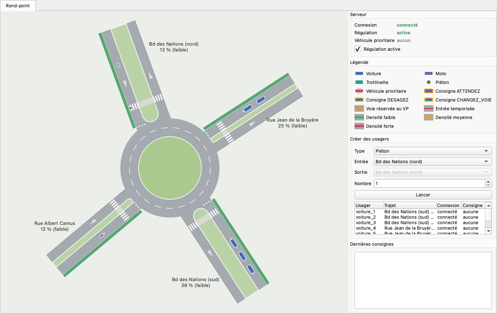
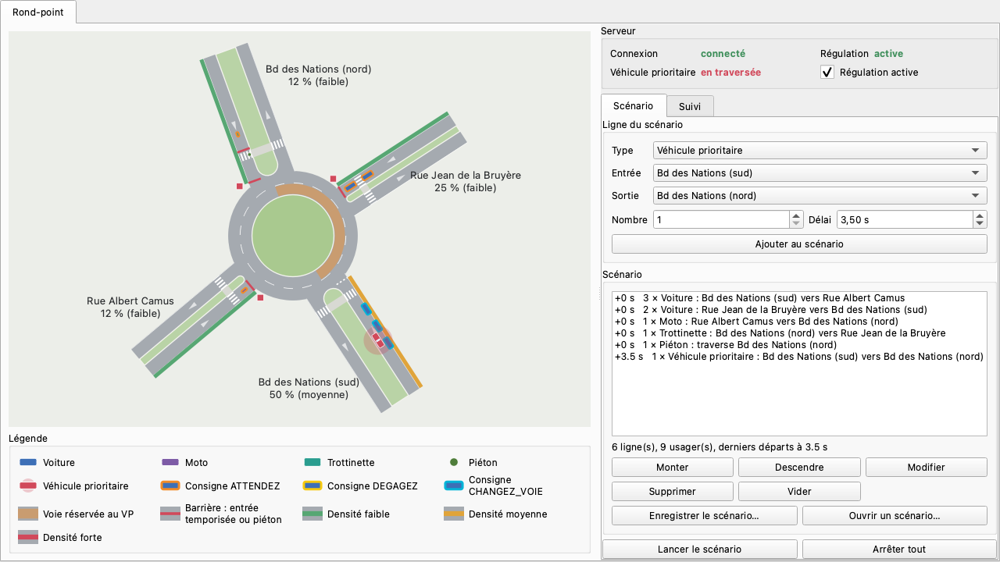
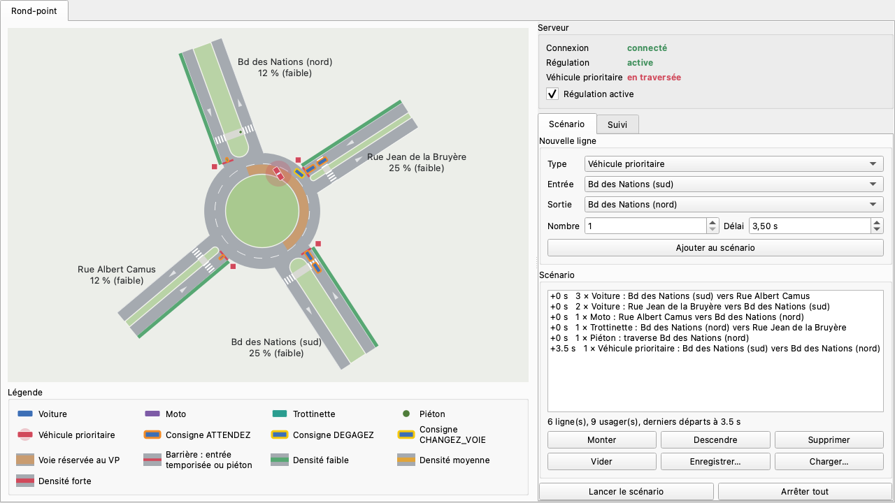
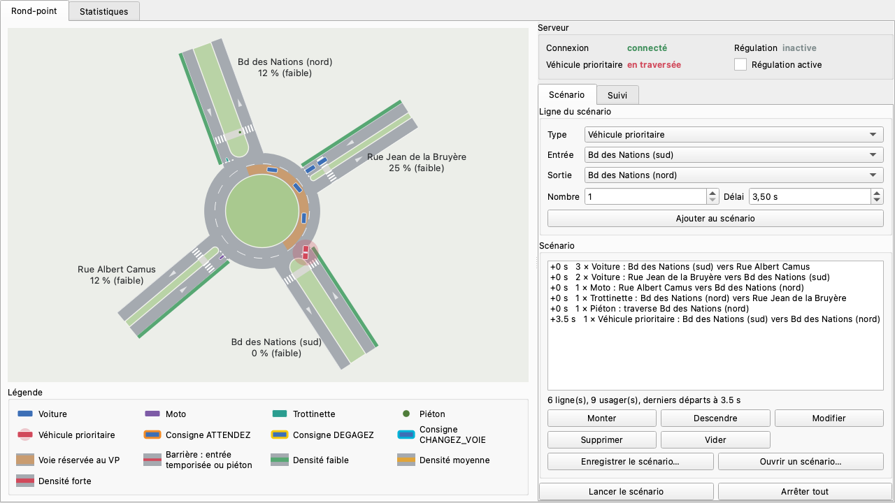
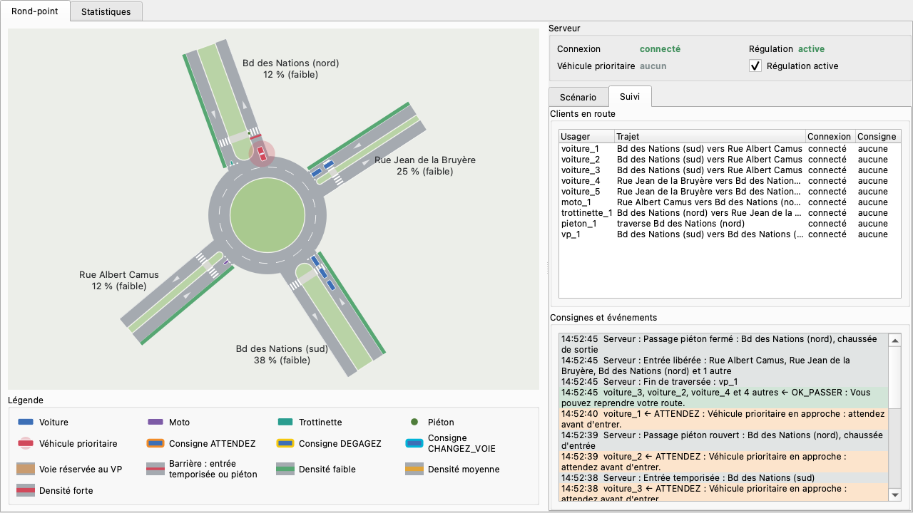

# CherryPie : rond-point connecté

Projet de la SAÉ 3.02 « Développer une application communicante » (BUT R&T, IUT de Colmar).

Maquette logicielle du rond-point sans feux situé vers l'arrêt Bel Air, à Mulhouse (rond-point André Marie Talvas). Tous les usagers (voitures, motos, trottinettes, piétons et véhicules prioritaires) sont connectés à un serveur qui représente le rond-point. Le but est de faire traverser un véhicule prioritaire le plus vite et le plus sûrement possible, en demandant aux autres usagers de lui laisser le passage.

L'application se découpe en trois parties :

- le **serveur**, qui tient le registre des usagers, calcule la densité de chaque branche et envoie les consignes ;
- les **clients usagers**, qui se déplacent sur le rond-point et suivent ces consignes ;
- la **supervision**, une fenêtre PyQt6 qui affiche le rond-point en 2D, permet de créer des usagers et présente les statistiques.

## Équipe

- Lucas Carriat
- Ilkan Guney

## Prérequis

- Python 3.11 ou plus récent

## Installation

```bash
git clone https://github.com/vRayzix/SAE3.02_Developper-une-application-communicante.git
cd SAE3.02_Developper-une-application-communicante
python3 -m venv .venv
source .venv/bin/activate          # sous Windows : .venv\Scripts\activate
pip install -r requirements.txt
cp config.exemple.ini config.ini   # sous Windows : copy config.exemple.ini config.ini
```

`config.ini` n'est pas versionné : il contient la clé HMAC partagée et les identifiants de la base. Les valeurs d'exemple sont à remplacer.

La configuration d'exemple décrit le rond-point de Bel Air : quatre branches en double chaussée (le boulevard des Nations, côté nord et côté sud, la rue Jean de la Bruyère et la rue Albert Camus), chacune dans sa section `[branche.<identifiant>]` avec son nom de rue, son cap, la largeur de son terre-plein et la position de son passage piéton, et un anneau à deux voies. Les mesures et les choix de modélisation sont dans [docs/geometrie_bel_air.md](docs/geometrie_bel_air.md).

## Lancer le serveur

```bash
python scripts/lancer_serveur.py                  # lit config.ini à la racine du dépôt
python scripts/lancer_serveur.py autre_config.ini
```

Le serveur écoute en TCP sur le port 5050 et en UDP sur le port 5051 (réglables dans `config.ini`), et journalise dans la console les connexions, les inscriptions et les trames refusées. Ctrl+C ou `kill` l'arrêtent proprement.

Ces ports évitent le 5000, que le récepteur AirPlay occupe déjà sur toutes les interfaces sous macOS.

## Lancer la supervision

```bash
python scripts/lancer_supervision.py                  # lit config.ini à la racine du dépôt
python scripts/lancer_supervision.py autre_config.ini
```

La fenêtre s'ouvre en plein écran et peut être lancée avant le serveur : elle s'y connecte dès qu'il répond, et s'y reconnecte s'il redémarre. Elle ne descend pas sous 1000 × 640 pixels, et tout y reste visible à cette taille, par exemple sur l'écran d'un MacBook. À gauche, elle montre :

- le rond-point en 2D, dessiné d'après `config.ini` : les deux chaussées de chaque branche et leur terre-plein, les deux voies de l'anneau, les passages piétons et le nom de chaque rue. La scène suit la taille de la fenêtre ;
- chaque usager à son gabarit, tourné dans son sens de marche, coloré selon sa catégorie et cerclé selon la consigne qu'il suit ; le véhicule prioritaire a un halo. Avec DEGAGEZ, on voit un usager passer de la voie intérieure à la voie extérieure ; avec CHANGEZ_VOIE, un usager devant le VP sur sa branche se range au bord de sa chaussée et s'arrête, puis le VP, qui roule sur la gauche de sa chaussée, le double ;
- en orange, la voie intérieure des segments réservés au véhicule prioritaire, et une barre rouge sur la ligne de chaque entrée temporisée, avec un feu à côté. Une barre rouge ferme aussi la demi-chaussée qu'un piéton est en train de traverser, et elle seule ;
- la densité de chaque branche, écrite en pourcentage sous le nom de la rue et rendue par la couleur de la bande le long de la chaussée d'entrée : vert pour faible, jaune pour moyenne, rouge pour forte ;
- la légende de tout cela, sous la scène.

À droite, un séparateur que l'on peut déplacer laisse la place à un panneau qui défile si la fenêtre manque de hauteur. On y trouve l'état de la connexion, la régulation en vigueur sur le serveur, la présence d'un véhicule prioritaire et l'interrupteur « Régulation active », qui active ou coupe la régulation sur le serveur. Viennent ensuite deux onglets.

- **Scénario** : on compose la suite des lancements. Pour chaque ligne, on choisit le type d'usager, la rue d'entrée, la rue de sortie (imposée pour un piéton), le nombre d'usagers et le délai de départ, compté en secondes depuis la ligne précédente, puis « Ajouter au scénario ». Les lignes se suppriment, se montent ou se descendent avec les boutons ou par glisser-déposer, et « Vider » efface tout. « Lancer le scénario » envoie les lignes dans l'ordre, chacune à son délai, avec un client par usager, qui se connecte au serveur comme n'importe quel autre. « Arrêter tout » annule les lignes pas encore parties et arrête les clients lancés. « Enregistrer… » et « Charger… » gardent un scénario dans un fichier JSON, pour rejouer la même démonstration.
- **Suivi** : les clients en route, avec leur trajet, l'état de leur connexion et la consigne qu'ils suivent, puis les dernières consignes reçues.

Fermer la fenêtre, ou faire Ctrl+C dans la console, annule le scénario en cours, arrête les clients lancés depuis la fenêtre et coupe la connexion au serveur.

### Captures

Les captures montrent le même scénario : trois voitures en file sur le boulevard des Nations côté sud, deux rue Jean de la Bruyère, une moto rue Albert Camus, une trottinette et un piéton sur le boulevard des Nations côté nord, tous lancés ensemble. Le véhicule prioritaire part 3,5 s plus tard et traverse le boulevard, du sud vers le nord. La capture du dépassement est prise 2,4 s après son départ, les deux suivantes 8 s après.

Avant l'arrivée du véhicule prioritaire :



Avec régulation, les trois voitures parties devant lui sur le boulevard se rangent au bord de leur chaussée et s'arrêtent ; il les double sans ralentir, en serrant la gauche :



Une fois doublées, elles reprennent leur voie et attendent sa sortie à leur ligne, comme les entrées qui croisent sa trajectoire. Il roule déjà sur la voie intérieure :



Sans régulation, il vient seulement d'atteindre l'anneau : il a attendu derrière la file, puis cédé le passage aux voitures déjà engagées :



La section « Suivi », peu après le passage du véhicule prioritaire :



La même fenêtre en 1024 × 640, 1280 × 720 et 1440 × 800 : [1024 × 640](docs/captures/fenetre_1024x640.png), [1280 × 720](docs/captures/fenetre_1280x720.png), [1440 × 800](docs/captures/fenetre_1440x800.png).

`python scripts/generer_captures.py` refait ces images : il lance un serveur et la fenêtre dans le même processus, sans rien afficher à l'écran.

## Tests

```bash
python -m pytest                  # tous les tests, environ 55 s
python -m pytest -m "not lent"    # sans le test de bout en bout, qui joue deux traversées en temps réel
```

## Organisation du dépôt

| Dossier | Contenu |
| --- | --- |
| `src/cherrypie/` | code de l'application : `commun`, `modele`, `serveur`, `client`, `ihm`, `bdd` |
| `tests/` | tests pytest |
| `docs/` | documentation technique : diagramme de classes, protocole, sécurité, captures d'écran |
| `scripts/` | scripts de lancement et de génération des captures |
| `Livrables/` | livrables rendus (QQOQCP, cahier des charges) |
| `RessourcesProjets/` | consignes et ressources fournies pour la SAÉ |
