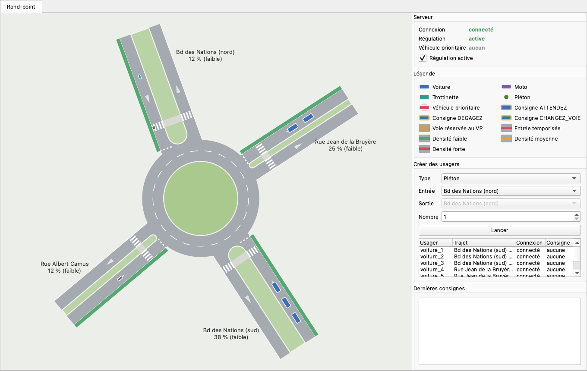
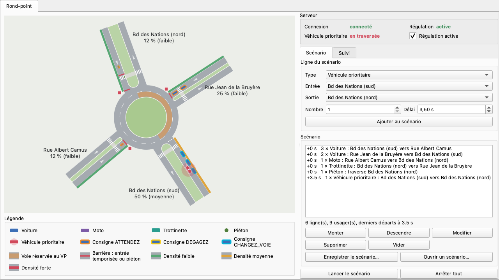
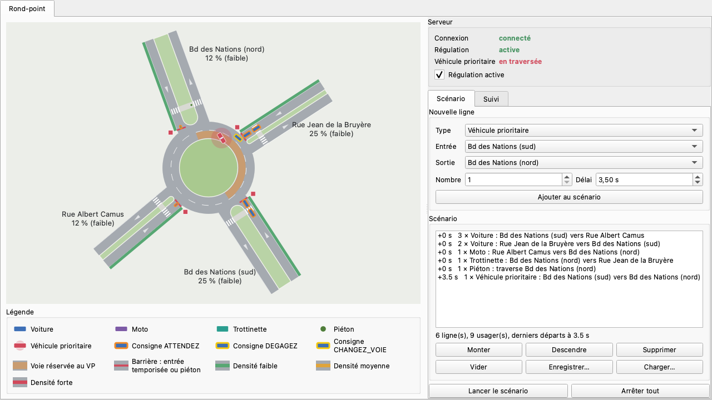
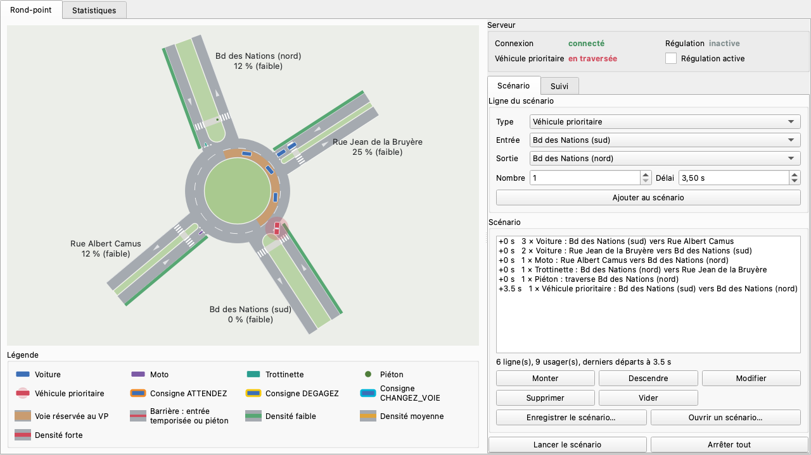
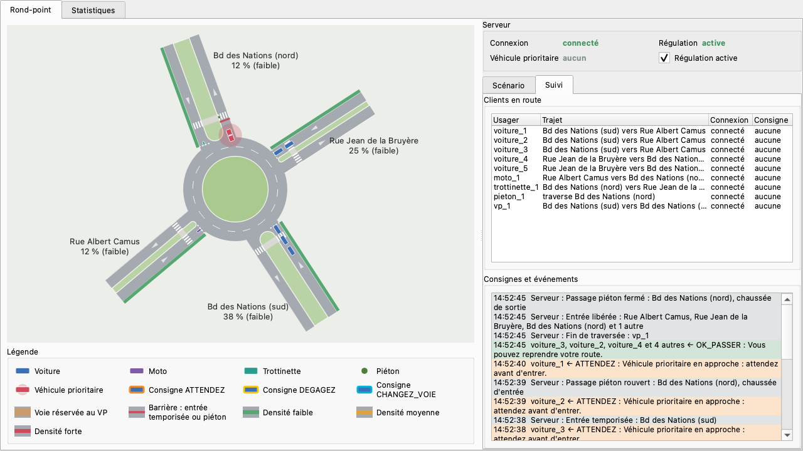
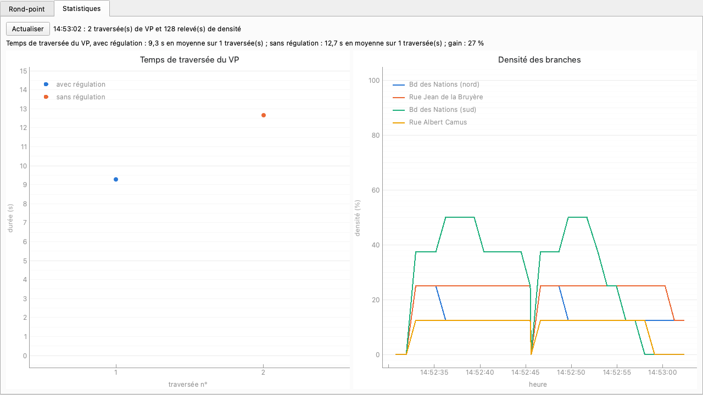

# CherryPie : rond-point connecté

Projet de la SAÉ 3.02 « Développer une application communicante » (BUT R&T, IUT de Colmar).

Maquette logicielle du rond-point sans feux situé vers l'arrêt Bel Air, à Mulhouse (rond-point André Marie Talvas). Tous les usagers (voitures, motos, trottinettes, piétons et véhicules prioritaires) sont connectés à un serveur qui représente le rond-point. Le but est de faire traverser un véhicule prioritaire le plus vite et le plus sûrement possible, en demandant aux autres usagers de lui laisser le passage.

L'application se découpe en trois parties :

- le **serveur**, qui tient le registre des usagers, calcule la densité de chaque branche, envoie les consignes et écrit l'historique dans une base MariaDB ;
- les **clients usagers**, qui se déplacent sur le rond-point et suivent ces consignes ;
- la **supervision**, une fenêtre PyQt6 qui affiche le rond-point en 2D, permet de créer des usagers et présente les statistiques.

## Équipe

Groupe CherryPie, BUT2 R&T de l'IUT de Colmar : Yassine et Ilkan.

## Prérequis

- Python 3.11 ou plus récent, avec le module `venv` (sous Debian : `sudo apt-get install -y python3-venv python3-pip`) ;
- git ;
- MariaDB pour l'historique et les statistiques (voir « Déploiement sur des VM Debian vierges »). Sans base, le serveur et la supervision fonctionnent : seules les statistiques manquent.

## Installation

```bash
git clone https://github.com/vRayzix/SAE3.02_Developper-une-application-communicante.git
cd SAE3.02_Developper-une-application-communicante
python3 -m venv .venv
source .venv/bin/activate          # sous Windows : .venv\Scripts\activate
pip install -r requirements.txt
```

`requirements.txt` ne contient que ce qu'il faut pour faire tourner le projet : PyQt6, pyqtgraph et mysql-connector-python, en versions exactes. Pour lancer les tests, on installe en plus les outils de développement :

```bash
pip install -r requirements-dev.txt   # requirements.txt, plus pytest et pytest-timeout
```

## Paramètres de lancement

Les trois scripts se règlent en ligne de commande ; `--help` liste les options de chacun. Chaque valeur vient, par ordre de priorité, de son option, de sa variable d'environnement, de `config.ini`, puis de la valeur par défaut :

| Option | Variable d'environnement | Clé de `config.ini` | Défaut | Scripts |
| --- | --- | --- | --- | --- |
| `--hote` | `CHERRYPIE_HOTE` | `[reseau] hote` | `127.0.0.1` | serveur (adresse d'écoute), supervision (adresse du serveur) |
| `--port-tcp` | `CHERRYPIE_PORT_TCP` | `[reseau] port_tcp` | `5050` | serveur, supervision |
| `--port-udp` | `CHERRYPIE_PORT_UDP` | `[reseau] port_udp` | `5051` | serveur, supervision |
| `--bdd-hote` | `CHERRYPIE_BDD_HOTE` | `[bdd] hote` | `localhost` | serveur, `init_bdd.py` |
| `--bdd-port` | `CHERRYPIE_BDD_PORT` | `[bdd] port` | `3306` | serveur, `init_bdd.py` |
| `--bdd-utilisateur` | `CHERRYPIE_BDD_UTILISATEUR` | `[bdd] utilisateur` | `cherrypie` | serveur, `init_bdd.py` |
| `--bdd-nom` | `CHERRYPIE_BDD_NOM` | `[bdd] base` | `cherrypie` | serveur, `init_bdd.py` |
| `--config` | | | `config.ini` à la racine, s'il existe | les trois |

La clé HMAC et le mot de passe de la base ne passent jamais en option, où `ps` les montrerait, ni par `config.ini`, qui finit copié : ils viennent de `CHERRYPIE_CLE` (serveur et supervision) et de `CHERRYPIE_BDD_MDP` (serveur et `init_bdd.py`). Si la variable manque et que le script tourne dans un terminal, il demande la valeur, sans l'afficher. Hors d'un terminal, il s'arrête en nommant la variable à définir. Une clé se génère par `python3 -c "import secrets; print(secrets.token_hex(32))"`.

`config.ini` est donc facultatif. Les autres valeurs (délais, géométrie du rond-point, réglages de la base) ont pour défaut celles de [config.exemple.ini](config.exemple.ini), où chaque clé est commentée. Pour en changer, on copie ce fichier en `config.ini` et on n'y garde que ce qui change. `config.ini` n'est pas versionné ; un `config.ini` qui contient encore `cle_hmac` ou `mot_de_passe` est refusé.

La configuration d'exemple décrit le rond-point de Bel Air : quatre branches en double chaussée (le boulevard des Nations, côté nord et côté sud, la rue Jean de la Bruyère et la rue Albert Camus), chacune dans sa section `[branche.<identifiant>]` avec son nom de rue, son cap, la largeur de son terre-plein et la position de son passage piéton, et un anneau à deux voies. Les mesures et les choix de modélisation sont dans [docs/geometrie_bel_air.md](docs/geometrie_bel_air.md).

## Lancer le serveur

```bash
python scripts/lancer_serveur.py                                     # 127.0.0.1, base sur localhost
python scripts/lancer_serveur.py --hote 0.0.0.0 --bdd-hote adresse-de-la-vm-bdd
python scripts/lancer_serveur.py --config autre_config.ini
```

Le serveur demande la clé HMAC et le mot de passe de la base s'ils ne sont pas dans `CHERRYPIE_CLE` et `CHERRYPIE_BDD_MDP`. Il écoute en TCP sur le port 5050 et en UDP sur le port 5051 (`--port-tcp`, `--port-udp`), et journalise dans la console les connexions, les inscriptions et les trames refusées. Ctrl+C ou `kill` l'arrêtent proprement.

Ces ports évitent le 5000, que le récepteur AirPlay occupe déjà sur toutes les interfaces sous macOS.

## Lancer la supervision

```bash
python scripts/lancer_supervision.py                               # serveur sur 127.0.0.1
python scripts/lancer_supervision.py --hote adresse-de-la-vm-code
```

La supervision demande la clé HMAC si elle n'est pas dans `CHERRYPIE_CLE` ; elle n'a besoin d'aucun accès à la base. La fenêtre s'ouvre en plein écran et peut être lancée avant le serveur : elle s'y connecte dès qu'il répond, et s'y reconnecte s'il redémarre. Elle ne descend pas sous 1000 × 640 pixels, et tout y reste visible à cette taille, par exemple sur l'écran d'un MacBook. À gauche, elle montre :

- le rond-point en 2D, dessiné d'après la configuration : les deux chaussées de chaque branche et leur terre-plein, les deux voies de l'anneau, les passages piétons et le nom de chaque rue. La scène suit la taille de la fenêtre ;
- chaque usager à son gabarit, tourné dans son sens de marche, coloré selon sa catégorie et cerclé selon la consigne qu'il suit ; le véhicule prioritaire a un halo. Avec DEGAGEZ, on voit un usager passer de la voie intérieure à la voie extérieure ; avec CHANGEZ_VOIE, un usager devant le VP sur sa branche se range au bord de sa chaussée et s'arrête, puis le VP, qui roule sur la gauche de sa chaussée, le double ;
- en orange, la voie intérieure des segments réservés au véhicule prioritaire, et une barre rouge sur la ligne de chaque entrée temporisée, avec un feu à côté. Une barre rouge ferme aussi la demi-chaussée qu'un piéton est en train de traverser, et elle seule ;
- la densité de chaque branche, écrite en pourcentage sous le nom de la rue et rendue par la couleur de la bande le long de la chaussée d'entrée : vert pour faible, jaune pour moyenne, rouge pour forte ;
- la légende de tout cela, sous la scène.

À droite, un séparateur que l'on peut déplacer laisse la place à un panneau qui défile si la fenêtre manque de hauteur. On y trouve l'état de la connexion, la régulation en vigueur sur le serveur, la présence d'un véhicule prioritaire et l'interrupteur « Régulation active », qui active ou coupe la régulation sur le serveur. Viennent ensuite deux onglets.

- **Scénario** : on compose la suite des lancements. Pour chaque ligne, on choisit le type d'usager, la rue d'entrée, la rue de sortie (imposée pour un piéton), le nombre d'usagers et le délai de départ, compté en secondes depuis la ligne précédente, puis « Ajouter au scénario ». Les lignes se suppriment, se montent ou se descendent avec les boutons ou par glisser-déposer, et « Vider » efface tout. Pour corriger une ligne, on la sélectionne puis « Modifier » (ou un double-clic) : ses valeurs reviennent dans le formulaire, et « Valider la modification » la remplace à sa place, sans changer l'ordre. « Lancer le scénario » envoie les lignes dans l'ordre, chacune à son délai, avec un client par usager, qui se connecte au serveur comme n'importe quel autre. « Arrêter tout » annule les lignes pas encore parties et arrête les clients lancés.

  « Enregistrer le scénario… » écrit la liste dans un fichier JSON, et « Ouvrir un scénario… » la recharge. C'est ce qui permet de mesurer ce qu'apporte la régulation : on joue un scénario avec la régulation active, on coupe l'interrupteur, puis on rouvre le même fichier et on le relance. Les deux traversées du véhicule prioritaire se font dans le même trafic, et l'écart entre leurs durées vient de la régulation seule.
- **Suivi** : les clients en route, avec leur trajet, l'état de leur connexion et la consigne qu'ils suivent. Dessous, une seule liste rassemble les messages, le plus récent en haut, une ligne par message : les consignes reçues par ces clients (« 15:31:14  voiture_3 ← DEGAGEZ : Véhicule prioritaire derrière vous : ralentissez et serrez à droite. »), et les événements du serveur : véhicule prioritaire annoncé, avec son trajet et son arrivée prévue à l'anneau, fin de sa traversée, entrée temporisée ou libérée, passage piéton fermé ou rouvert, régulation activée ou coupée. Chaque ligne a la couleur de sa consigne (orange pour ATTENDEZ, jaune pour DEGAGEZ, bleu clair pour CHANGEZ_VOIE, vert pour OK_PASSER, gris pour un événement). Un message identique au précédent complète sa ligne au lieu d'en ouvrir une : « voiture_1, voiture_2 et 3 autres ← OK_PASSER », « Entrée libérée : Rue Albert Camus, Bd des Nations (sud) ». La liste garde les 100 derniers messages.

Un second onglet de la fenêtre, **Statistiques**, montre le temps de traversée de chaque véhicule prioritaire, en bleu avec régulation et en orange sans, avec le temps moyen de chaque mode et le gain, puis la densité de chaque branche dans le temps. La supervision ne se connecte jamais à la base : à l'ouverture de l'onglet, ou par « Actualiser », elle demande les statistiques au serveur, qui les lit en base et les lui renvoie. Si la base est injoignable, l'onglet le dit.

Fermer la fenêtre, ou faire Ctrl+C dans la console, annule le scénario en cours, arrête les clients lancés depuis la fenêtre et coupe la connexion au serveur.

### Captures

Les captures montrent le même scénario : trois voitures en file sur le boulevard des Nations côté sud, deux rue Jean de la Bruyère, une moto rue Albert Camus, une trottinette et un piéton sur le boulevard des Nations côté nord, tous lancés ensemble. Le véhicule prioritaire part 3,5 s plus tard et traverse le boulevard, du sud vers le nord. La capture du dépassement est prise 2,4 s après son départ, les deux suivantes 8 s après.

Avant l'arrivée du véhicule prioritaire :



Avec régulation, les trois voitures parties devant lui sur le boulevard se rangent au bord de leur chaussée et s'arrêtent ; il les double sans ralentir, en serrant la gauche :



Une fois doublées, elles reprennent leur voie et attendent sa sortie à leur ligne, comme les entrées qui croisent sa trajectoire. Il roule déjà sur la voie intérieure :



Sans régulation, il vient seulement d'atteindre l'anneau : il a attendu derrière la file, puis cédé le passage aux voitures déjà engagées :



La section « Suivi », peu après le passage du véhicule prioritaire :



La même fenêtre en 1024 × 640, 1280 × 720 et 1440 × 800 : [1024 × 640](docs/captures/fenetre_1024x640.png), [1280 × 720](docs/captures/fenetre_1280x720.png), [1440 × 800](docs/captures/fenetre_1440x800.png).

L'onglet Statistiques, après ces deux traversées :



`python scripts/generer_captures.py` refait ces images : il lance un serveur et la fenêtre dans le même processus, sans rien afficher à l'écran.

## Scénarios de démonstration

`docs/scenario_demonstration.json` est le scénario des captures : trois voitures en file sur le boulevard des Nations côté sud, deux rue Jean de la Bruyère, une moto, une trottinette et un piéton, puis le véhicule prioritaire 3,5 s plus tard, du sud vers le nord. Pour mesurer ce qu'apporte la régulation :

1. lancer le serveur, puis la supervision ;
2. dans l'onglet Scénario, « Ouvrir un scénario… » et choisir `docs/scenario_demonstration.json`, puis « Lancer le scénario » ;
3. une fois le véhicule prioritaire sorti, décocher « Régulation active » ;
4. relancer le même scénario ;
5. ouvrir l'onglet Statistiques : les deux traversées y sont, avec le temps moyen de chaque mode et le gain.

Chaque scénario composé dans la supervision s'enregistre de la même façon (« Enregistrer le scénario… ») pour être rejoué à l'identique.

## Historique en base

Le serveur écrit dans MariaDB :

- chaque traversée de véhicule prioritaire : début, fin, durée, durée sur l'anneau, régulation active ou non, densité moyenne pendant la traversée (table `passage_vp`) ;
- toutes les `intervalle_releves` secondes, la densité de chaque branche (table `releve_densite`) ;
- chaque connexion et chaque déconnexion d'usager, avec sa raison (table `evenement_connexion`).

`python scripts/init_bdd.py` crée ces tables à partir de `src/cherrypie/bdd/schema.sql`. Il vise la base de `--bdd-hote`, `--bdd-port`, `--bdd-utilisateur` et `--bdd-nom` (voir « Paramètres de lancement »), avec le mot de passe de `CHERRYPIE_BDD_MDP` ou saisi au clavier. Il se relance sans rien perdre. S'il échoue, il dit pourquoi (serveur injoignable, accès refusé, base absente) et ce qu'il faut vérifier.

L'écriture se fait dans un thread à part : la boucle du serveur n'attend jamais la base. Si MariaDB est injoignable, le serveur fonctionne normalement. Il journalise la panne une fois, garde l'historique en mémoire et retente la connexion toutes les `delai_reessai` secondes. La section `[bdd]` règle aussi le délai de connexion (`delai_connexion`). Un `config.ini` copié d'une version précédente doit perdre `cle_hmac` et `mot_de_passe` : le serveur refuse de démarrer tant qu'ils y sont, et nomme la variable d'environnement qui les remplace.

## Déploiement sur des VM Debian vierges

Le déploiement sépare trois machines :

| Machine | Rôle | Paquets Debian |
| --- | --- | --- |
| VM bdd (Debian server, sans écran) | MariaDB seule | `mariadb-server` |
| VM code (Debian server, sans écran) | serveur du rond-point | `git`, `python3-venv`, `python3-pip`, `mariadb-client` |
| poste IHM (avec écran) | supervision, et clients lancés depuis la supervision | `git`, `python3-venv`, `python3-pip`, bibliothèques de Qt |

Le dépôt ne contient ni adresse de machine ni secret : chaque machine commence par une ligne à adapter (l'adresse de l'autre machine), et le mot de passe de la base comme la clé HMAC se saisissent au clavier, sans écho. Aucun `config.ini` n'est nécessaire.

Avant de commencer, sur chaque machine :

- un utilisateur qui a le droit d'utiliser `sudo`. Si Debian a été installée avec un mot de passe root, `sudo` n'y est pas : en root (`su -`), `apt-get install -y sudo && adduser <utilisateur> sudo`, puis se reconnecter ;
- l'heure juste : les trames sont refusées si les horloges s'écartent de plus de 5 s (anti-rejeu). `timedatectl` doit afficher `System clock synchronized: yes`, sinon `sudo apt-get install -y systemd-timesyncd`.

Chaque machine a deux blocs, à coller dans l'ordre. Le premier se modifie avant d'être collé : il installe les paquets et, s'il le faut, demande le mot de passe. Ses commandes tiennent sur une seule ligne, pour que `sudo` et la saisie du mot de passe ne lisent pas, à la place de ce qu'on tape, des lignes collées après eux. Le second se colle tel quel, dans la même console.

### 1. VM bdd

```bash
IP_VM_CODE=adresse-de-la-vm-code
sudo apt-get update && sudo apt-get install -y mariadb-server && read -rsp "Mot de passe à donner à l'utilisateur MariaDB cherrypie : " CHERRYPIE_BDD_MDP && echo
```

```bash
sudo sed -i 's/^bind-address\s*=.*/bind-address = 0.0.0.0/' /etc/mysql/mariadb.conf.d/50-server.cnf
sudo systemctl enable mariadb
sudo systemctl restart mariadb
sudo mariadb <<SQL
CREATE DATABASE IF NOT EXISTS cherrypie CHARACTER SET utf8mb4;
CREATE OR REPLACE USER 'cherrypie'@'$IP_VM_CODE' IDENTIFIED BY '$CHERRYPIE_BDD_MDP';
GRANT ALL PRIVILEGES ON cherrypie.* TO 'cherrypie'@'$IP_VM_CODE';
SQL
unset CHERRYPIE_BDD_MDP
sudo mariadb -e "SELECT user, host FROM mysql.user WHERE user = 'cherrypie'"
```

La dernière commande affiche `cherrypie` et l'adresse de la VM code. Le mot de passe est placé dans une chaîne SQL : il ne doit contenir ni apostrophe ni antislash. MariaDB écoute désormais sur toutes les interfaces, mais l'utilisateur `cherrypie` n'est accepté que depuis la VM code. Debian n'active pas de pare-feu par défaut ; si `ufw` est actif : `sudo ufw allow from "$IP_VM_CODE" to any port 3306 proto tcp`.

### 2. VM code

```bash
IP_VM_BDD=adresse-de-la-vm-bdd
sudo apt-get update && sudo apt-get install -y git python3-venv python3-pip mariadb-client && read -rsp "Mot de passe MariaDB de l'utilisateur cherrypie : " CHERRYPIE_BDD_MDP && echo && export CHERRYPIE_BDD_MDP
```

```bash
git clone https://github.com/vRayzix/SAE3.02_Developper-une-application-communicante.git
cd SAE3.02_Developper-une-application-communicante
python3 -m venv .venv
.venv/bin/pip install -r requirements.txt
.venv/bin/python scripts/init_bdd.py --bdd-hote "$IP_VM_BDD"
export CHERRYPIE_CLE="$(.venv/bin/python -c 'import secrets; print(secrets.token_hex(32))')"
echo "Clé HMAC à saisir sur le poste IHM : $CHERRYPIE_CLE"
.venv/bin/python scripts/lancer_serveur.py --hote 0.0.0.0 --bdd-hote "$IP_VM_BDD"
```

`init_bdd.py` affiche `Base prête sur <adresse>:3306` ; s'il échoue, il dit pourquoi (serveur injoignable, accès refusé, base absente) et quoi vérifier. Le serveur affiche ensuite `Serveur du rond-point démarré sur 0.0.0.0 (TCP 5050, UDP 5051)` et reste au premier plan ; Ctrl+C ou `kill` l'arrêtent proprement. Notez la clé affichée : le poste IHM en a besoin, et le serveur la redemande s'il est relancé dans une autre console.

PyQt6 s'installe avec les autres dépendances, mais ni le serveur ni `init_bdd.py` ne le chargent : ils tournent sans écran. `mariadb-client` sert à vérifier l'accès à la main : `mariadb -h "$IP_VM_BDD" -u cherrypie -p cherrypie -e "SHOW TABLES"`. Si `ufw` est actif : `sudo ufw allow 5050/tcp` et `sudo ufw allow 5051/udp`. Pour fermer la session SSH sans arrêter le serveur, on le lance dans `tmux` (`sudo apt-get install -y tmux`).

### 3. Poste IHM

Sous Debian ou Ubuntu, avec un bureau :

```bash
IP_VM_CODE=adresse-de-la-vm-code
sudo apt-get update && sudo apt-get install -y git python3-venv python3-pip libxcb-cursor0 libxkbcommon-x11-0 libegl1 libgl1
```

```bash
git clone https://github.com/vRayzix/SAE3.02_Developper-une-application-communicante.git
cd SAE3.02_Developper-une-application-communicante
python3 -m venv .venv
.venv/bin/pip install -r requirements.txt
.venv/bin/python scripts/lancer_supervision.py --hote "$IP_VM_CODE"
```

Les bibliothèques `libxcb-cursor0`, `libxkbcommon-x11-0`, `libegl1` et `libgl1` sont celles que Qt 6 réclame le plus souvent sur un bureau Debian (« Could not load the Qt platform plugin "xcb" »).

Sous Windows, avec Python 3.11 ou plus récent (python.org) et Git for Windows, dans PowerShell, depuis un dossier au chemin court comme le dossier personnel (Windows limite les chemins à 260 caractères, et ceux du dépôt sont déjà longs) :

```powershell
$IP_VM_CODE = "adresse-de-la-vm-code"
git clone https://github.com/vRayzix/SAE3.02_Developper-une-application-communicante.git
cd SAE3.02_Developper-une-application-communicante
py -m venv .venv
.venv\Scripts\pip install -r requirements.txt
.venv\Scripts\python scripts\lancer_supervision.py --hote $IP_VM_CODE
```

La supervision demande la clé HMAC (`Clé HMAC partagée (CHERRYPIE_CLE) :`), celle qu'a affichée la VM code, puis ouvre sa fenêtre. Les clients lancés depuis la fenêtre tournent sur le poste et envoient leurs positions à la VM code, sur les mêmes ports. La supervision peut aussi être lancée avant le serveur : elle s'y connecte dès qu'il répond.

### Relancer après un redémarrage

MariaDB redémarre seul (`systemctl enable`). Sur la VM code puis sur le poste, depuis le dossier du dépôt :

```bash
.venv/bin/python scripts/lancer_serveur.py --hote 0.0.0.0 --bdd-hote adresse-de-la-vm-bdd
```

```bash
.venv/bin/python scripts/lancer_supervision.py --hote adresse-de-la-vm-code
```

Sans `CHERRYPIE_CLE` ni `CHERRYPIE_BDD_MDP` dans l'environnement, chaque programme demande ce qui lui manque. La clé doit être la même sur les deux machines.

## Tout en local

Pour développer, tout tourne sur une seule machine : MariaDB, serveur et supervision. Les valeurs par défaut visent déjà cette machine (`127.0.0.1` pour le serveur, `localhost` pour la base) : aucune option n'est nécessaire. On installe MariaDB, puis on crée la base et l'utilisateur, autorisé depuis la machine elle-même (`sudo mariadb`) :

```sql
CREATE DATABASE cherrypie CHARACTER SET utf8mb4;
CREATE USER 'cherrypie'@'localhost' IDENTIFIED BY 'mot_de_passe_a_choisir';
GRANT ALL PRIVILEGES ON cherrypie.* TO 'cherrypie'@'localhost';
```

Puis, dans deux consoles, chaque programme demandant la clé ou le mot de passe qui lui manque (la même clé dans les deux consoles) :

```bash
python scripts/init_bdd.py
python scripts/lancer_serveur.py
```

```bash
python scripts/lancer_supervision.py
```

Pour ne pas les retaper, on les met dans l'environnement de la console (`export CHERRYPIE_CLE=...`, `export CHERRYPIE_BDD_MDP=...` ; sous PowerShell, `$env:CHERRYPIE_CLE = "..."`).

Sans MariaDB, le serveur et la supervision fonctionnent quand même. Le serveur signale une fois que la base est injoignable, et l'onglet Statistiques indique qu'elles sont indisponibles.

## Tests

Les tests demandent `requirements-dev.txt` (voir l'installation).

```bash
python -m pytest                  # tous les tests, environ 80 s
python -m pytest -m "not lent"    # sans les tests qui jouent des traversées en temps réel, environ 30 s
```

Aucun test n'a besoin de MariaDB : le serveur testé écrit dans une doublure de la base, qui garde tout en mémoire. Le seul test qui vise une vraie base (marqué `bdd`) la trouve comme `init_bdd.py`, sans option : variables `CHERRYPIE_BDD_*`, `config.ini` à la racine s'il existe, valeurs par défaut. Il est ignoré si `CHERRYPIE_BDD_MDP` n'est pas définie ou si la base est injoignable. `python -m pytest -m bdd` le lance seul.

Chaque test a 60 s au plus (`timeout` dans `pytest.ini`) : un test bloqué échoue, avec la pile de chaque thread, au lieu de figer la suite.

## Organisation du dépôt

```
src/cherrypie/
├── commun/    configuration et paramètres de lancement, erreurs, messages, découpage des trames, HMAC et anti-rejeu
├── modele/    usagers, rond-point (branches, segments), trajectoires, positions
├── serveur/   boucle select, logique, registre, densité, circulation, régulation, passages des VP
├── client/    client usager (connexion, heartbeat, reconnexion) et déplacement
├── ihm/       fenêtre de supervision, scène 2D, réseau en QThread, scénario, suivi, statistiques
└── bdd/       schema.sql, AccesBdd, historique écrit dans son thread
tests/         un fichier test_<module>.py par module, doublures de la base et simulation
docs/          diagramme de classes, protocole, sécurité, géométrie de Bel Air, captures, scénario
scripts/       lancement du serveur et de la supervision, création des tables, génération des captures
Livrables/     livrables rendus (QQOQCP, cahier des charges)
RessourcesProjets/  consignes et ressources fournies pour la SAÉ
```

| Fichier | Rôle |
| --- | --- |
| `config.exemple.ini` | valeurs par défaut et modèle d'un `config.ini` facultatif, une ligne de commentaire par clé |
| `requirements.txt` | dépendances d'exécution, versions exactes |
| `requirements-dev.txt` | dépendances de test (pytest, pytest-timeout), en plus des précédentes |
| `pytest.ini` | chemin des sources, marqueurs `lent` et `bdd`, délai de 60 s par test |
