# Diagramme de classes prévisionnel

Ce document décrit les classes prévues avant le développement. Il sera ajusté au fil de l'avancement, le diagramme final étant celui du code rendu.

Dépendances entre paquets : `commun` ne dépend d'aucun autre paquet ; `modele` utilise `commun` ; `serveur` et `client` utilisent `commun` et `modele` ; `ihm` lance des clients et lit la base ; seul `serveur` écrit dans `bdd`.

## Conventions

| Notation | Signification | En Python |
| --- | --- | --- |
| `-` | privé | attribut `self.__nom` ou méthode `__nom()` |
| `#` | protégé | méthode `_nom()`, réservée à la classe et à ses sous-classes |
| `+` | public | méthode ou propriété sans préfixe |
| souligné | membre de classe | constante de classe, `@classmethod` ou `@staticmethod` |
| `<<dataclass>>` | objet valeur | `@dataclass(frozen=True)`, champs publics en lecture seule |
| `<<enumeration>>` | énumération | sous-classe de `Enum` |

Tous les attributs d'instance sont privés, sauf les champs des objets valeur. Chacun est lu depuis l'extérieur par une propriété `@property` du même nom. Un setter n'existe que si l'attribut doit changer après la construction : il valide la valeur et lève une exception si elle est incohérente. Les setters prévus sont listés sous chaque diagramme. Les constructeurs ne sont pas représentés.

Relations : triangle vide pour l'héritage, losange plein pour la composition (la partie n'existe pas sans le tout), losange vide pour l'agrégation (le tout référence des objets qui existent sans lui), flèche simple pour l'association, flèche pointillée pour une dépendance ponctuelle.

## Paquet `commun`

### Erreurs métier

Toutes les erreurs du projet héritent de `CherryPieError`. Le serveur peut ainsi distinguer une trame refusée, qu'il journalise puis ignore, d'un vrai bug.

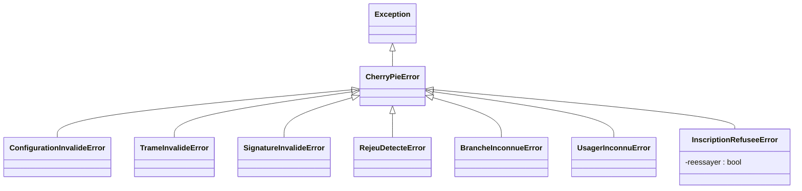

### Configuration, protocole, trames et sécurité

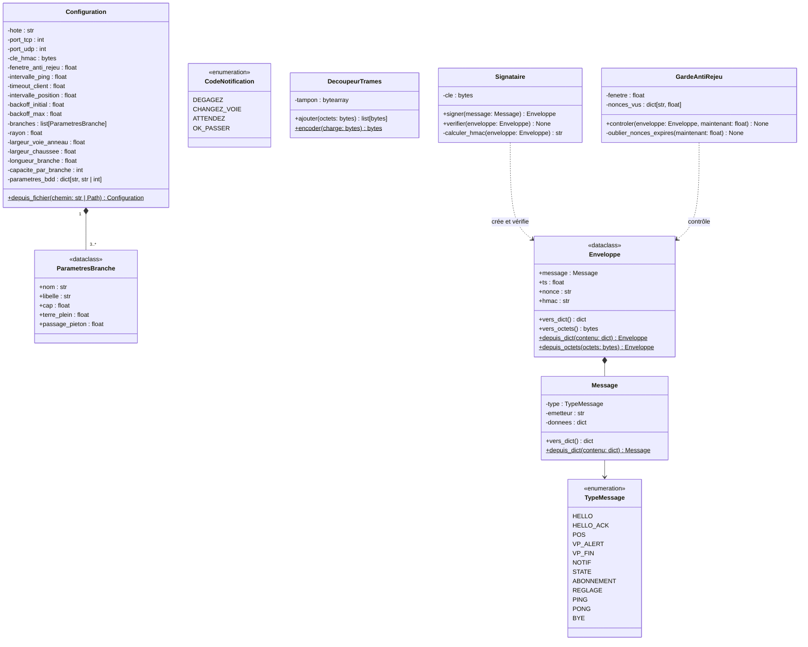

- `Enveloppe` est la forme transmise sur le réseau : le `Message`, plus l'horodatage, le nonce et le HMAC. `Signataire.signer()` la construit ; à la réception, `Signataire.verifier()` puis `GardeAntiRejeu.controler()` la valident.
- `ParametresBranche` décrit une branche telle que la donne sa section `[branche.<identifiant>]` de `config.ini` : identifiant (celui du protocole), libellé affiché, cap depuis le nord, largeur du terre-plein et distance du passage piéton. La configuration refuse un identifiant qui n'est pas en minuscules sans accents, une section sans branche, deux branches au même cap, ou une voie d'anneau plus large que le rayon.
- `CodeNotification` fait partie du protocole plutôt que du serveur, parce que le client en a besoin pour réagir aux consignes.
- `DecoupeurTrames` tient le tampon d'une socket TCP : `ajouter()` renvoie les trames complètes et garde le reste pour la lecture suivante.

Setters prévus : aucun, ces objets ne changent plus une fois construits.

## Paquet `modele`

### Usagers

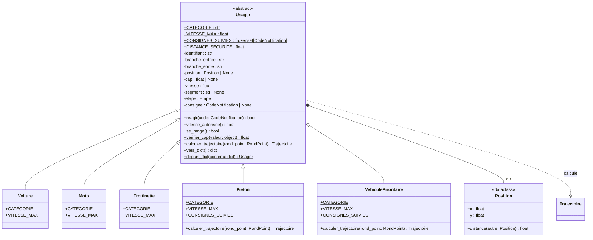

`Usager.reagir()` applique la consigne reçue si elle fait partie de `CONSIGNES_SUIVIES` et renvoie `True` ; sinon il l'ignore et renvoie `False`. Chaque sous-classe redéfinit ce qui lui est propre :

| Classe | Catégorie | Vitesse max | Consignes suivies | Trajectoire |
| --- | --- | --- | --- | --- |
| `Voiture` | `voiture` | 8,3 m/s (30 km/h) | toutes | approche, anneau, sortie |
| `Moto` | `moto` | 8,3 m/s (30 km/h) | toutes | approche, anneau, sortie |
| `Trottinette` | `trottinette` | 5,6 m/s (20 km/h) | toutes | approche, anneau, sortie |
| `Pieton` | `pieton` | 1,4 m/s (5 km/h) | `ATTENDEZ`, `OK_PASSER` | traversée de sa branche |
| `VehiculePrioritaire` | `vp` | 11,1 m/s (40 km/h) | aucune, c'est lui qu'on laisse passer | approche, anneau sur la voie intérieure, sortie |

- `vitesse_autorisee()` et `se_range()` traduisent la consigne en cours : vitesse réduite de moitié pour `DEGAGEZ`, et rangement sur la droite pour `DEGAGEZ` et `CHANGEZ_VOIE`. La place disponible dépend de l'endroit (bord de la chaussée sur une branche, voie extérieure sur l'anneau) : c'est la trajectoire qui la donne, et le déplacement qui l'applique. `ATTENDEZ` ne change pas la vitesse : l'usager avance jusqu'à la ligne d'entrée de sa trajectoire et s'y arrête. `OK_PASSER` lève la consigne.
- `Pieton` redéfinit `calculer_trajectoire()` : il ne prend pas l'anneau, il traverse une seule branche, qui est à la fois son entrée et sa sortie. `VehiculePrioritaire` la redéfinit aussi, pour rester sur la voie intérieure de l'anneau.
- Le cap est la direction de marche, en degrés depuis le nord. `verifier_cap()` sert au setter et au serveur, qui contrôle le cap d'un POS avant de modifier l'usager.
- `depuis_dict()` instancie la bonne sous-classe d'après la catégorie reçue dans le HELLO.
- `Position` a son propre module (`modele/position.py`), partagé par les usagers, le rond-point et les trajectoires. Elle refuse les coordonnées infinies ou NaN.

Setters : `Usager.position`, `Usager.cap` (entre 0 et 360), `Usager.vitesse` (entre 0 et la vitesse maximale de la catégorie), `Usager.segment` et `Usager.etape`, mis à jour par le client quand il avance et par le serveur à chaque POS reçu. L'étape vaut `APPROCHE` tant que l'usager n'a pas bougé.

### Rond-point

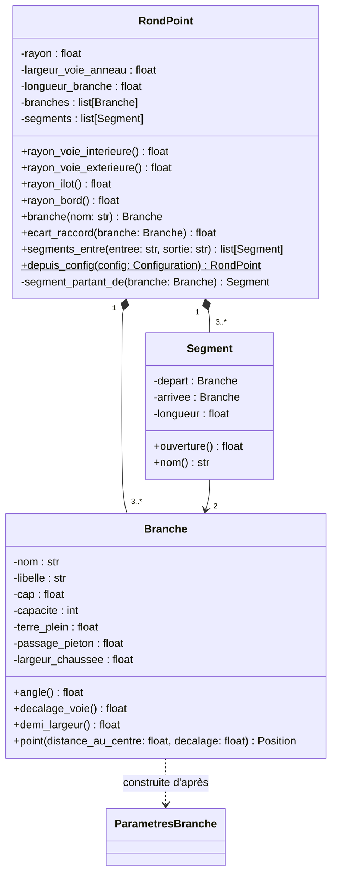

- `RondPoint` crée ses branches et ses segments à partir de la configuration, et ils n'existent pas sans lui : composition. La géométrie de Bel Air est décrite dans [geometrie_bel_air.md](geometrie_bel_air.md).
- Chaque branche est placée à son cap ; `angle` le convertit en angle du repère (90° moins le cap). Elle a deux chaussées d'une voie, de part et d'autre d'un terre-plein : `decalage_voie` est l'écart entre l'axe et le milieu de chaque chaussée, `demi_largeur` l'écart jusqu'à leur bord extérieur. La chaussée d'entrée est à droite d'un usager qui arrive.
- L'anneau a deux voies de même largeur, séparées par son axe (`rayon`). `ecart_raccord()` donne l'angle entre l'axe d'une branche et le milieu de ses chaussées au bord de l'anneau : on entre un peu après l'axe, on sort un peu avant.
- Les segments suivent le sens de circulation, quel que soit l'ordre des branches dans la configuration. Pour Bel Air, `segments_entre("nations_sud", "nations_nord")` renvoie `nations_sud-jean_de_la_bruyere` puis `jean_de_la_bruyere-nations_nord`. Si l'entrée et la sortie sont la même branche, l'usager fait le tour complet.
- `RondPoint.branche()` lève `BrancheInconnueError` pour un nom qui n'existe pas.

Setters : aucun, la géométrie ne change plus une fois le rond-point construit.

### Trajectoires

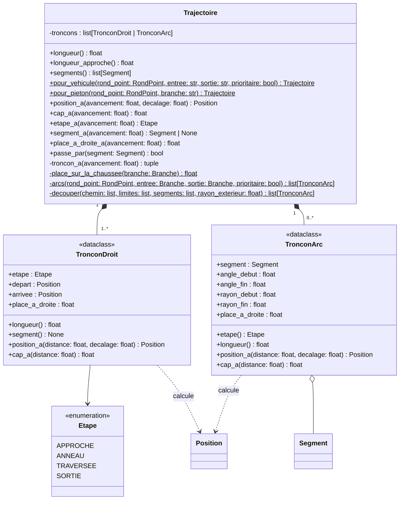

- Une trajectoire est une suite de tronçons parcourus l'un après l'autre : des tronçons droits sur les chaussées des branches (approche, sortie, passage piéton) et des morceaux d'arc sur l'anneau. Les deux types de tronçons offrent les mêmes membres (`etape`, `longueur`, `segment`, `place_a_droite`, `position_a()`, `cap_a()`) : la trajectoire trouve le tronçon qui correspond à l'avancement et lui délègue le calcul.
- Un véhicule approche sur la chaussée d'entrée, depuis le bout de la branche jusqu'au bord de l'anneau : c'est la ligne d'entrée, où il s'arrête s'il doit attendre (`longueur_approche`). Il repart sur la chaussée de sortie de sa branche de sortie.
- Sur l'anneau, `arcs()` décrit le chemin par des points (angle, distance au centre) : raccord depuis la chaussée d'entrée, voie suivie, changement de voie éventuel, raccord vers la chaussée de sortie. Un véhicule qui sort à la première sortie suit la voie extérieure ; les autres suivent la voie intérieure jusqu'au segment qui mène à leur sortie, où ils se rabattent sur la voie extérieure ; le VP reste sur la voie intérieure. `decouper()` coupe ce chemin aux limites des segments, et découpe finement les transitions pour que l'usager y avance à vitesse régulière.
- `place_a_droite` est l'écart qu'un usager peut prendre pour se ranger : le bord de sa chaussée sur une branche, la largeur d'une voie sur la voie intérieure, rien sur la voie extérieure.
- Un piéton parcourt 4 m de trottoir jusqu'au bord de la chaussée d'entrée, traverse les deux chaussées et le terre-plein sur le passage piéton, puis repart sur le trottoir d'en face : il croise l'approche et la sortie des véhicules de cette branche.
- Le décalage latéral se compte vers la droite du sens de marche ; sur l'anneau, c'est l'extérieur. Le cap se compte depuis le nord, dans le sens des aiguilles d'une montre ; `cap_de_la_direction()` convertit une direction du repère en cap.
- Un point situé pile à la jonction de deux tronçons appartient au premier : un usager arrêté sur la ligne d'entrée est encore en approche.
- Les arcs ne font que référencer les segments du rond-point, sans les posséder : agrégation.

Setters : aucun, une trajectoire ne change plus une fois calculée.

## Paquet `serveur`

### Boucle réseau et logique

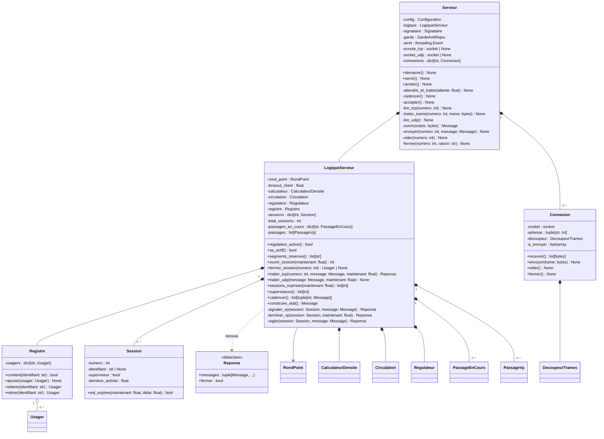

- La boucle réseau et la logique sont séparées. `Serveur` ne décide rien ; `LogiqueServeur` ne touche aucune socket, ce qui permet de la tester sans réseau. Elles se parlent par numéro de session : la boucle associe chaque numéro à une `Connexion` (la socket et ses tampons), la logique à une `Session` (usager, abonnement, dernière activité).
- `servir()` fait tourner une seule boucle `select` sur la socket d'écoute TCP, la socket UDP et les sockets des clients. Son délai d'attente court jusqu'à la prochaine cadence (`intervalle_etat`) : à chaque cadence, `cadencer()` ferme les sessions silencieuses et envoie le STATE aux supervisions. `arreter()` lève un `threading.Event` vérifié à chaque tour, ce qui arrête la boucle en moins d'un intervalle.
- Chaque trame reçue passe par `ouvrir()` (enveloppe, HMAC, anti-rejeu) avant d'être confiée à la logique. Une trame refusée est journalisée puis ignorée.
- `Connexion` utilise une socket non bloquante. Son découpeur recolle les trames reçues en plusieurs morceaux ou collées ensemble, et sa file d'envoi garde ce que la socket n'a pas pu accepter, jusqu'à ce que `select` la signale prête à écrire. Un client qui laisse plus de 1 Mio en attente est déconnecté.
- Aux frontières, une erreur imprévue sur une session ne ferme que cette session ; ailleurs dans la boucle, elle est journalisée et la boucle continue.

Setters : `Session.identifiant` (une seule fois, au HELLO), `Session.superviseur` (à l'ABONNEMENT) et `Session.derniere_activite` (à chaque message reçu, jamais en arrière).

### Densité et véhicules prioritaires

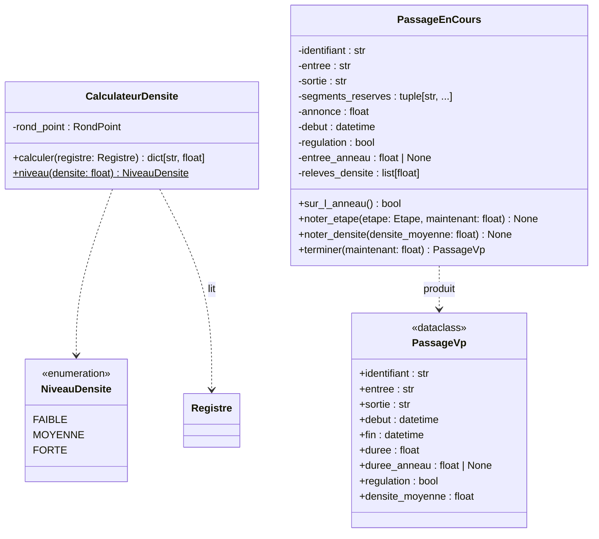

- `CalculateurDensite` compte, pour chaque branche, les usagers en approche sur cette branche (ceux qui roulent vers l'anneau ou attendent d'y entrer) et divise par sa capacité, en bornant à 1. `niveau()` applique les seuils du cahier des charges : faible en dessous de 0,4, moyenne en dessous de 0,7, forte au-delà.
- Un VP_ALERT crée un `PassageEnCours`, qui réserve les segments de la trajectoire du VP et démarre le chronomètre, en notant le mode de régulation en vigueur. Le premier POS du VP sur l'anneau note son entrée sur l'anneau, et `cadencer()` relève la densité moyenne des branches à chaque cadence. Le VP_FIN produit un `PassageVp`, une mesure figée (durée de l'annonce au VP_FIN, durée sur l'anneau seule) que `LogiqueServeur.passages` conserve pour l'enregistrement en base.
- `cadencer()` regroupe ce que la logique fait à chaque cadence : relevés de densité, puis un STATE par supervision. La boucle réseau n'a plus qu'à envoyer ce qu'elle renvoie.

### Ce que voit chaque conducteur

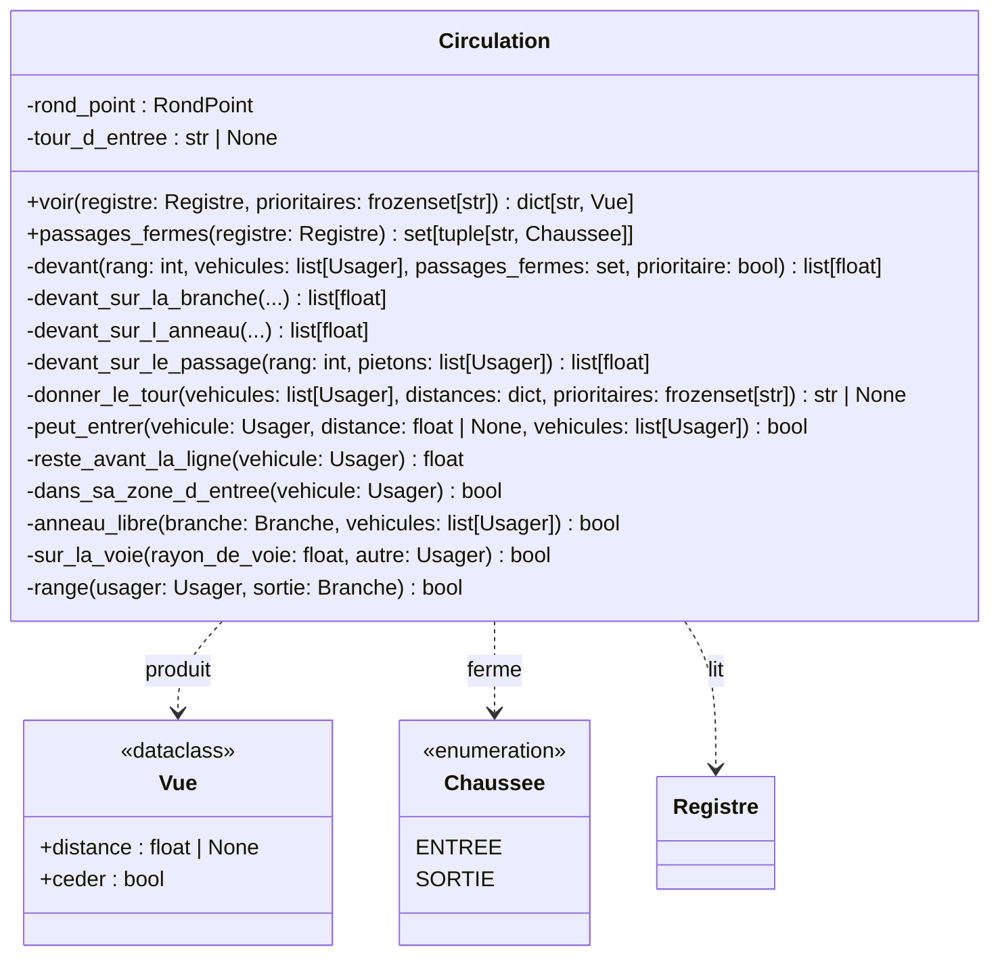

- Chaque client roule sans voir les autres. `Circulation.voir()` calcule, pour chaque véhicule dont la position est connue, la distance jusqu'à l'obstacle le plus proche devant lui sur sa voie (autre véhicule ou piéton sur le passage) et s'il doit céder le passage. `cadencer()` l'envoie à chaque véhicule dans un message DEVANT, que la régulation soit active ou non : c'est la simulation de ce que voit un conducteur, pas une consigne.
- Sur une chaussée de branche, deux véhicules sont sur la même file si leurs écarts à l'axe diffèrent de moins d'un mètre : un usager rangé sur le bord ne gêne pas ceux qui roulent au milieu. Sur l'anneau, deux véhicules sont sur la même voie si leurs distances au centre diffèrent de moins d'une demi-largeur de voie.
- Le cédez-le-passage demande 15 m libres en amont et 10 m en aval du point d'entrée, sur les deux voies, puisque l'usager qui entre traverse la voie extérieure. Ces marges empêchent l'anneau de se bloquer en boucle.
- Les entrées se font une par une. `donner_le_tour()` accorde l'entrée à un seul véhicule proche de sa ligne, qui la garde pendant qu'il rejoint l'anneau ; c'est le seul état que `Circulation` retient d'une cadence à l'autre (`tour_d_entree`).
- `prioritaires` désigne les VP annoncés quand la régulation est active : ils entrent sans attendre leur tour et ne regardent que la voie intérieure.
- `passages_fermes()` donne les demi-chaussées où marche un piéton : seules celles-là bloquent les véhicules, et le STATE les transmet à la supervision. Un piéton voit le piéton qui le précède sur le passage, pour ne pas lui marcher dessus.

### Régulation

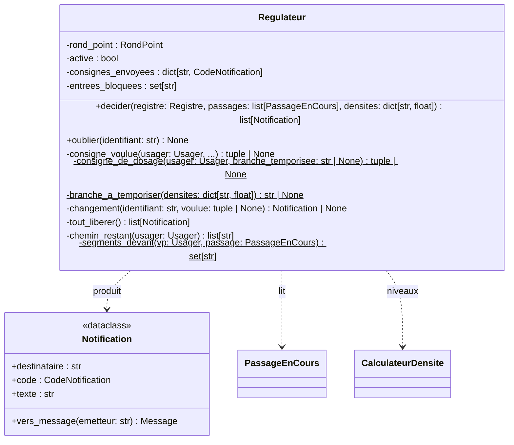

- `Regulateur.decider()` est appelé à chaque cadence par `cadencer()`. Il calcule la consigne voulue pour chaque usager, la compare à celle déjà envoyée (`consignes_envoyees`) et ne renvoie que les changements ; un usager libéré reçoit OK_PASSER.
- Autour d'un VP : DEGAGEZ pour qui est ou va passer sur un segment réservé devant le VP, CHANGEZ_VOIE pour la file sur la branche d'entrée du VP, ATTENDEZ pour qui entrerait sur un segment réservé, et ATTENDEZ pour les piétons devant les passages de l'entrée et de la sortie du VP. Sans VP, le dosage temporise la moins chargée des entrées occupées quand une branche est en densité forte.
- `oublier()` est appelé à la fermeture d'une session : après une reconnexion, la consigne qui vaut encore est renvoyée.
- Régulation coupée (`active` à False, message REGLAGE), `decider()` lève une fois les consignes en cours puis ne renvoie plus rien.

Setters : `Regulateur.active` (message REGLAGE).

## Paquet `client`

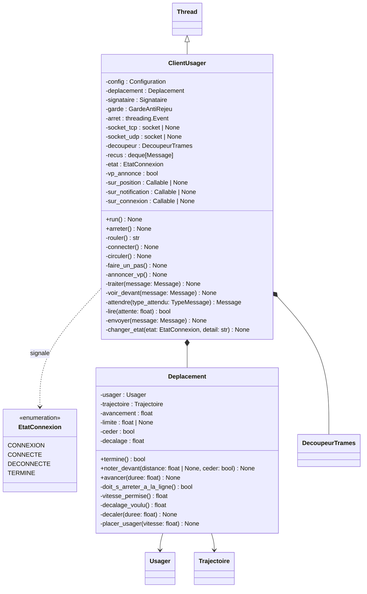

- Chaque `ClientUsager` est un `threading.Thread` avec ses propres sockets. Il ne dépend pas de Qt : il signale sa position, les consignes reçues et l'état de sa connexion par trois fonctions de rappel, appelées depuis son thread. L'IHM les relie à des signaux Qt par un `RelaisClient`, sans que le client touche jamais un widget. La position est transmise sous forme de copie (`Usager.vers_dict()`), jamais par l'objet partagé.
- `rouler()` enchaîne les connexions. Après une coupure, ou un refus provisoire (`InscriptionRefuseeError.reessayer`), il attend avec un délai qui double (1, 2, 4, 8 s, plafonné à 10 s). L'attente se fait sur un `threading.Event` : `arreter()` réveille le client sans attendre la fin du délai. Un refus définitif l'arrête.
- `circuler()` fait avancer l'usager d'un pas à chaque intervalle de position, envoie le POS en UDP, envoie un PING toutes les `intervalle_ping` secondes et traite les messages reçus. Elle s'arrête si le serveur reste muet plus de `timeout_client` secondes, et dit au revoir (BYE) à la fin du trajet ou à l'arrêt.
- Les messages lus attendent dans une file (`recus`) : une NOTIF arrivée dans la même lecture que le HELLO_ACK n'est pas perdue.
- `Deplacement` contient les règles de mouvement, sans réseau, ce qui permet de les tester seules. À chaque pas, l'usager parcourt la distance que permet sa consigne et s'arrête sur la ligne d'entrée pendant un ATTENDEZ ou un cédez-le-passage s'il ne l'a pas encore franchie. Pour se ranger, il se décale progressivement (2 m/s) jusqu'à la place que donne sa trajectoire ; pendant un DEGAGEZ, il ne ralentit qu'une fois rangé, pour ne pas boucher la voie qu'il libère. Chaque pas met à jour sa position, son cap, sa vitesse, son segment et son étape. `noter_devant()` fixe l'avancement à ne pas dépasser pour garder sa distance de sécurité avec l'obstacle de devant (`Usager.DISTANCE_SECURITE` : 6 m pour un véhicule, 1,5 m pour un piéton) ; l'usager ne recule jamais.
- Un client de VP envoie VP_ALERT à chaque connexion tant que le VP n'a pas quitté l'anneau, avec son `eta` (le temps qu'il lui faut pour atteindre l'anneau), puis VP_FIN au pas où il passe en étape de sortie.

Setters prévus : aucun.

## Paquet `ihm`

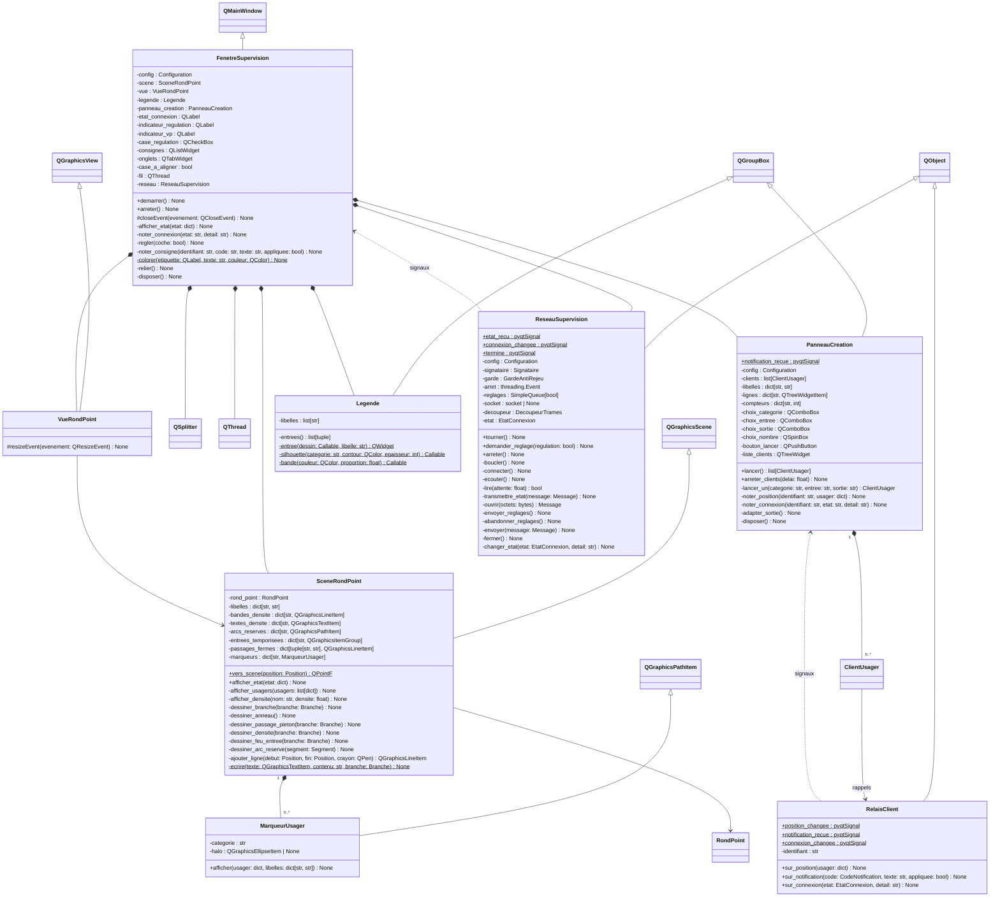

- Trois sortes de threads se partagent la supervision : le thread de l'IHM, qui possède tous les widgets ; le `QThread` du réseau, où vit `ReseauSupervision` après `moveToThread()` ; un `threading.Thread` par `ClientUsager` lancé depuis le panneau. Seul le thread de l'IHM touche aux widgets. Les deux autres émettent des signaux, que Qt remet aux objets de l'IHM dans leur thread (connexion en file d'attente).
- Les signaux sont des attributs de classe (`pyqtSignal`), d'où le soulignement. `etat_recu` porte les données d'un STATE (`dict`), `connexion_changee` l'état de la connexion et un détail (`str, str`), `termine` n'a pas d'argument. Les signaux de `RelaisClient` commencent par l'identifiant de l'usager : `position_changee (str, dict)`, `notification_recue (str, str, str, bool)` pour le code, le texte et l'application de la consigne, `connexion_changee (str, str, str)`. `PanneauCreation.notification_recue` relaie ce dernier vers la fenêtre.
- `ReseauSupervision.tourner()` est relié au signal `started` du `QThread`. Comme le client, la boucle se connecte, s'abonne (ABONNEMENT), envoie un PING toutes les `intervalle_ping` secondes et se reconnecte avec le même backoff. Un STATE auquel il manque un champ est journalisé et ignoré, pour ne jamais faire échouer l'affichage.
- Tant que `tourner()` s'exécute, le `QThread` ne revient pas à sa boucle d'événements : un slot appelé en file d'attente n'y serait jamais exécuté. Les réglages demandés par l'IHM passent donc par une `SimpleQueue`, que la boucle vide à chaque tour ; l'attente sur la socket est bornée à 0,1 s pour qu'un réglage ou l'arrêt soit pris en compte vite. Les réglages demandés hors connexion sont abandonnés à la connexion suivante.
- `termine` est relié à `QThread.quit()` en connexion directe : à la fermeture, le thread de l'IHM attend le réseau dans `wait()` et ne traiterait pas un signal en file d'attente.
- `RelaisClient` adapte les rappels du client, qui ne dépend pas de Qt. Créé dans le thread de l'IHM, il émet un signal à chaque rappel. Le client garde ses fonctions de rappel, donc le relais, aussi longtemps qu'il vit.
- `SceneRondPoint` travaille en mètres, comme le modèle, avec l'ordonnée inversée (`vers_scene()`), et ne recalcule rien : elle montre l'état reçu. La chaussée est dessinée une fois d'après le rond-point : deux chaussées par branche avec leur terre-plein, lignes de rive, ligne de cédez-le-passage, passage piéton et refuge, flèches de sens, deux voies sur l'anneau. La voie intérieure des segments réservés et les entrées temporisées (barre sur la ligne et feu) sont posées cachées et rendues visibles d'après le STATE. Le niveau de densité reprend `CalculateurDensite.niveau()`, pour que les seuils restent ceux du serveur. Le cadre de la scène suit le dessin ; `VueRondPoint` le recadre à chaque changement de taille.
- `MarqueurUsager` dessine un usager à son gabarit (`style.py`), tourné selon le cap reçu dans le STATE. L'avant d'un véhicule est sur sa position : arrêté sur la ligne d'entrée, il la touche. Le VP a un halo et une rampe lumineuse.
- La fenêtre place la scène et les panneaux (serveur, légende, création, consignes) de part et d'autre d'un `QSplitter` : la scène prend toute la hauteur, et l'utilisateur peut lui donner plus de largeur.
- `style.py` réunit couleurs, tailles et libellés : la scène et la légende utilisent les mêmes constantes, si bien qu'une couleur changée l'est partout.
- L'interrupteur envoie un REGLAGE sur `clicked`, émis seulement par un clic, jamais par `setChecked()`. Après chaque connexion, la case reprend l'état du serveur au premier STATE ; ensuite, seul l'indicateur suit le serveur. Elle est grisée tant que la supervision n'est pas connectée.
- `closeEvent()` redéfinit la méthode protégée de Qt : il arrête et attend les clients lancés depuis le panneau, puis le réseau, avant de fermer la fenêtre.

Setters prévus : aucun.

## Paquet `bdd` (prévisionnel)

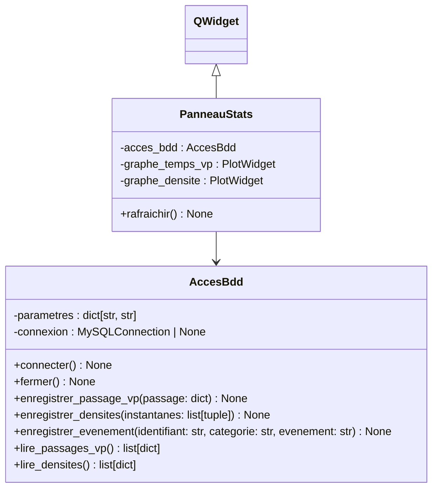

- `PanneauStats` sera un onglet « Statistiques » de `FenetreSupervision`.
- `AccesBdd` utilise des requêtes paramétrées et `executemany` pour les instantanés de densité. Le serveur est le seul à écrire ; `PanneauStats` ne fait que lire.

Setters prévus : aucun.
